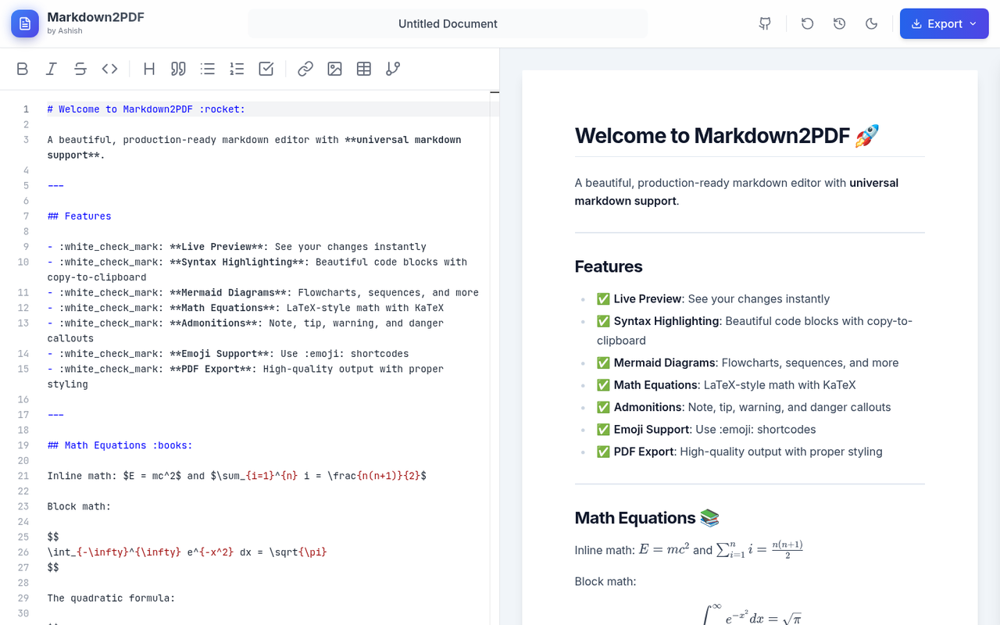

# Markdown2PDF – Free Markdown to PDF & Word Converter

**[▶ Try it live: markdown-to-pdf-pi.vercel.app](https://markdown-to-pdf-pi.vercel.app/)**

Convert Markdown to PDF or Word (.docx) right in your browser. Live A4 preview, Mermaid diagrams, LaTeX math, syntax highlighting and GitHub Flavored Markdown. Free, no signup, and nothing is uploaded: your document never leaves your device.

[](https://markdown-to-pdf-pi.vercel.app/)

**Guides:** [Markdown to Word](https://markdown-to-pdf-pi.vercel.app/markdown-to-word) · [README to PDF](https://markdown-to-pdf-pi.vercel.app/readme-to-pdf) · [Mermaid to PDF](https://markdown-to-pdf-pi.vercel.app/mermaid-to-pdf) · [Markdown math to PDF](https://markdown-to-pdf-pi.vercel.app/markdown-math-to-pdf) · [Markdown cheat sheet](https://markdown-to-pdf-pi.vercel.app/markdown-cheat-sheet)

## 🚀 Features

- **Real-time Preview**: See your changes instantly as you type.
- **Split-Screen Interface**: Code editor on the left, live preview on the right.
- **Multi-Format Export**: PDF (A4, via the print dialog), Word `.docx`, and the raw `.md` source.
- **PDF (exact layout)**: An alternative PDF export that rasterises the fixed-width print target, bypassing the browser's print stack entirely. Byte-for-byte identical on every device — useful when a mobile browser mis-renders the print dialog. Text is not selectable and the file is larger.
- **Syntax Highlighting**: Uses Monaco Editor (VS Code's editor) for a premium writing experience.
- **Dark Mode**: Fully supported dark theme for comfortable writing in low light.
- **Local Persistence**: Your work is automatically saved to your browser's local storage, so you never lose data.
- **Fully Offline**: Monaco is served from this app's own origin, not a third-party CDN, so nothing about your document leaves the browser.
- **Markdown Support**:
  - GitHub Flavored Markdown (GFM)
  - Tables
  - Code blocks with syntax highlighting
  - Lists, links, and images
  - Typography styling

## 🛠️ Tech Stack

- **Framework**: [React](https://react.dev/) (via [Vite](https://vitejs.dev/))
- **Language**: [TypeScript](https://www.typescriptlang.org/)
- **Styling**: [Tailwind CSS](https://tailwindcss.com/) + [@tailwindcss/typography](https://github.com/tailwindlabs/tailwindcss-typography)
- **Editor**: [Monaco Editor](https://microsoft.github.io/monaco-editor/)
- **Markdown Engine**: [react-markdown](https://github.com/remarkjs/react-markdown) + [remark-gfm](https://github.com/remarkjs/remark-gfm)
- **PDF Generation**: [react-to-print](https://github.com/gregnb/react-to-print)
- **DOCX Generation**: [mdast2docx](https://github.com/md2docx/mdast2docx) (lazy-loaded; built on [docx](https://docx.js.org/))
- **Icons**: [Lucide React](https://lucide.dev/)

## 📦 Installation

1.  **Clone the repository**
    ```bash
    git clone https://github.com/Akm592/markdown-to-pdf.git
    cd markdown-to-pdf
    ```

2.  **Install dependencies**
    ```bash
    npm install
    ```

3.  **Start the development server**
    ```bash
    npm run dev
    ```

4.  **Build for production**
    ```bash
    npm run build
    ```

## 📂 Project Structure

```
markdown-to-pdf/
├── src/
│   ├── components/
│   │   ├── Editor.tsx           # Monaco wrapper (desktop)
│   │   ├── MobileEditor.tsx     # Textarea editor (small screens)
│   │   ├── Header.tsx           # Top navigation and actions
│   │   ├── ExportMenu.tsx       # PDF / Word / Markdown menu
│   │   ├── MarkdownDocument.tsx # Shared renderer (preview + print)
│   │   ├── Preview.tsx          # On-screen A4 sheet
│   │   ├── PrintDocument.tsx    # Off-screen fixed-width print target
│   │   └── Toolbar.tsx          # Markdown insertion tools
│   ├── hooks/
│   │   ├── useLocalStorage.ts   # Debounced persistence
│   │   ├── useDebouncedValue.ts # Keeps typing off the render path
│   │   └── useMediaQuery.ts     # Chooses the editor for the viewport
│   ├── lib/
│   │   ├── markdownPlugins.ts   # Shared remark config (preview + export)
│   │   ├── exportDocx.ts        # Lazy-loaded DOCX pipeline
│   │   ├── exportPdfImage.ts    # Lazy-loaded raster PDF pipeline
│   │   ├── print.ts             # Fixed-width print config (A4)
│   │   └── download.ts          # Blob download helper
│   ├── App.tsx             # Main application layout and logic
│   ├── index.css           # Global styles and Tailwind directives
│   └── main.tsx            # Entry point
├── seo/
│   ├── pages.ts            # Landing pages: titles, descriptions, guide copy, FAQs
│   └── plugin.ts           # Builds one HTML file per page + sitemap, robots.txt, llms.txt, 404
├── public/                 # Icons, social preview image, web manifest
├── index.html              # HTML template (SEO blocks filled by seo/plugin.ts)
├── vercel.json             # Clean URLs and asset caching
├── tailwind.config.js      # Tailwind configuration
└── vite.config.ts          # Vite configuration
```

## 🎨 Customization

### Themes
The application uses Tailwind CSS for styling. You can customize the color palette and typography in `tailwind.config.js`.

### PDF Styling
PDF styles are defined in `src/index.css` under the `@media print` query. You can adjust margins, page sizes, and hide specific elements during printing.

### DOCX Styling
Word output is assembled in `src/lib/exportDocx.ts`. Page size and margins are set there (A4 at 2cm, matching the PDF), and the plugin list controls which markdown features are converted.

### Print Layout
`src/lib/print.ts` pins the print iframe to the A4 printable width (170mm). This matters because `react-to-print` sizes its iframe to the device viewport, and mobile browsers map that layout onto the page directly — without the override, phone exports come out squeezed into a narrow column.

### SEO and landing pages
Each landing page (`/`, `/markdown-to-word`, `/readme-to-pdf`, …) is the same editor app with its own title, description, structured data and a written guide below the editor. The guide is plain HTML outside React's root, so search engines read it without running JavaScript. To add a page, add an entry to `seo/pages.ts`; the build writes its HTML file and adds it to the sitemap.

The canonical domain follows Vercel's production domain automatically. Set a `SITE_URL` environment variable to override it.

## 🤝 Contributing

Contributions are welcome! Please feel free to submit a Pull Request.

1.  Fork the project
2.  Create your feature branch (`git checkout -b feature/AmazingFeature`)
3.  Commit your changes (`git commit -m 'Add some AmazingFeature'`)
4.  Push to the branch (`git push origin feature/AmazingFeature`)
5.  Open a Pull Request

## �‍💻 Author

**Ashish**

- GitHub: [@Akm592](https://github.com/Akm592)

## 🔗 Repository

- **GitHub Repo**: [https://github.com/Akm592/markdown-to-pdf](https://github.com/Akm592/markdown-to-pdf)

## �📄 License

This project is licensed under the MIT License - see the LICENSE file for details.
